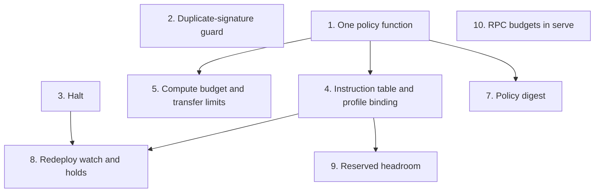

# Hardening proposals

Proposals for the signer. A proposal that has shipped says **Status: built** and how the build differs from the proposal, if at all; the rest are not built. Each names the threat it addresses (in the terms of [Security](../security.md)), what changes in `src/`, the config keys, refusals and audit fields it adds, how it is tested, its priority, and how it interacts with the others. Priorities: **blocker** (fix before relying on the signer), **high** (a real gap at low cost), **low** (worth doing when nearby work touches it), **optional** (only if a need appears). There are no blockers. Each proposal has a line in the [Plan](plan.md)'s backlog; this chapter holds the reasoning.

Three facts frame them:

- **The signer is thin on purpose.** It checks what the chain does not, does not decode game instructions, and needs no IDL ([How it works](../how-it-works.md)). Proposal 4 adds an opt-in table of each instruction's shape (discriminator, account count, profile slots), generated from the IDLs into its own data file; it still decodes nothing.
- **It is non-custodial for anything of value.** In Path B the human's wallet holds the profile; the signer holds a narrow, expiring session key ([Choosing a setup](../setup.md)). Nothing here makes it easier to hold the profile authority unattended.
- **It is testnet-only and agent-facing.** The requester is an agent that can be prompt-injected, so every field a payload or its `summary` supplies is untrusted. Checks key on the compiled message, configured state, and what the signer reads from the chain itself.

A check that refuses what was signed before is a breaking change ([Versioning](contributing.md#versioning)). Proposals that add one say so, and ship first as a report-only mode where that is practical.

## Build order

1. Proposals 2 and 3 first: small, independent, and they close a wrong outcome and a missing control.
2. Proposal 1 next: a refactor with no behaviour change except `check`'s preview, and the base the later checks plug into.
3. Then 5, then 4 in report mode, then 4 enforced.
4. Then 7, 8, 9 and 10 as the need appears; 11 to 13 whenever convenient.

## 1. One policy function for check and sign

**Threat:** a clean `check` that `sign` then refuses (the rate limit, the daily cap, a `deny` key, approval), so an agent plans on a payload it cannot send; and checks that are hard to test because they interleave with RPC and audit-log reads.

**Today:** `checks::structural` is already pure over the message and a `Policy`. The new-accounts and token-account-owner checks, the limits and approval are not: they read the RPC or the audit log in the middle of `engine::preflight`.

**Status: built.** How it differs from the proposal below:

- `check` does not refuse a `deny` key: it previews it as `approval` in `sign_preview`, and its `outcome` stays `ok`. That keeps this change non-breaking; refusing it in `check` remains open.
- The facts step reads the RPC one fact at a time in check order (genesis hash, then partial signers, then token-account owners), and `evaluate` runs after each read. A refusal is decided only when every check before it has passed, so a refusal decided without the RPC (a wrong fee payer, a `deny` key, a halt) is still made before any RPC call, as before. `Facts` holds the key's usage (signs in the last minute, lamports spent or reserved in 24 h) already counted from the audit log at the time it was read, so `evaluate` needs no clock.
- `check`'s preview of the cap uses `AfterSimulation` with `check`'s own simulated spend and fee once its simulation passes, so it matches what `sign` would compute for the same transaction.
- The approval prompt, the stale-blockhash and duplicate-signature guards stay in the engine: they rebuild the transaction rather than judge it. After them, `sign` refreshes the usage from the audit log and evaluates again at `AfterSimulation`.
- `check` now reads the audit log and the halt record, for the preview: an unreadable audit log fails a `check` as it already failed a `sign`.

**Change:**

- A `policy` module with one function, `evaluate(message, &Facts, &KeyPolicy, Stage) -> Verdict`. `Facts` holds everything read from outside, gathered first: the owners of token-account owners, whether partial signers exist, the key's signs in the last minute and lamports spent or reserved in 24 h (from the audit log), the halt state (proposal 3), and later program deploy slots (proposal 8). `Stage` is `Check`, `BeforeSimulation` or `AfterSimulation` (with the simulated spend and fee for the cap).
- A `facts` step does all the I/O. `evaluate` does none, reads no clock (the time is a field of `Facts`), and returns every failed check in order, not only the first.
- `check` evaluates the sign-only gates too and reports them in a new `sign_preview` field: the checks `sign` would refuse now, and `needs_approval: true` for a `confirm` key. `check`'s outcome stays `ok` when only sign-only gates fail, so this part is not breaking. Refusing a `deny` key in `check`, as the backlog item proposes, is breaking: ship it with a `feat!:` commit.
- `sign` calls the same function before and after simulation, so the two paths cannot drift.

**Tests:** table-driven tests of `evaluate` with no RPC and no files, one row per check and its refusal; a test that `check` and `sign` give the same verdict on the same `Facts`; the existing engine tests unchanged.

**Priority:** high, and first among the larger items. **Interactions:** it is where proposals 4 to 9 add their checks; it supersedes the backlog's "check previews the sign-only checks".

## 2. Duplicate-signature guard

**Threat:** ed25519 signatures are deterministic, so the same instructions with the same blockhash give the same signature. If an agent sends the same payload twice (two identical cargo moves, say) and the RPC returns the same latest blockhash both times, the second send is the first transaction again: the cluster drops it as a duplicate, its status lookup finds the first one, and the signer reports `confirmed` for an action that happened once. Nothing in `engine.rs` checks for this today.

**Status: built.** The guard runs just before the cap gate rather than after it, so the cap is checked once, on the transaction actually sent; the outcome is the same. A repeat is detected by signature, which also covers the case where the RPC returns the same blockhash again.

**Change:** after the cap gate and before the intent is recorded, under the key lock, look up the transaction's signature among this key's audit entries from the last 24 h (intents and final entries). If it is there, fetch a fresh blockhash and re-simulate once, as the `BlockhashNotFound` path already does, and re-run the cap gate on the new figures. If the RPC still returns the same blockhash, refuse with `failed_check` `blockhash` and a detail saying nothing was sent and a retry is safe. Add `duplicate` to `checks` when the guard passes.

**Tests:** a fake chain that returns one blockhash for two identical payloads: the second sign gets a new blockhash and a different signature; a fake chain that can only return that blockhash: the second sign is refused and nothing is sent; a confirm key whose approval rebuild already changed the blockhash passes untouched.

**Priority:** high: the false outcome is the kind the retry rules exist to prevent. **Interactions:** the approval rebuild and the one-time re-sign on `BlockhashNotFound`; the audit log is the lookup, so CLI and `serve` signs share it.

## 3. Halt

**Threat:** under `serve`, the only ways to stop one key are editing `approval = "deny"` and restarting, or stopping the service with its 230 s drain. An operator who sees something wrong needs a stop that takes effect on the next request and does not lift itself.

**Status: built.** How it differs from the proposal below:

- `check` reports a halt in a `sign_preview` field with a `refusals` list, added here ahead of proposal 1, which adds the other sign-only gates and `needs_approval` to it.
- `halt_after_unknown` is a per-key setting (default 3, `0` never). A landed outcome (`confirmed` or `failed`) or a `resume` resets the count; refused and failed-simulation signs neither count nor reset it. The default refuses signs that were allowed before, so it shipped as a breaking change.
- A token's halt without `key` writes one halt per key the token lists, never the halt on every key. It does not wait for the key lock, so a sign already running finishes.
- `resume` without `--key` lifts only the halt on every key; each key's own halt needs `resume --key`. Audit entries for the halt on every key use `key` `*`.

**Change:**

- `sa-forge-signer halt [--key <name>] --reason <text>` writes a halt record under `state_dir` (all keys, or one) and appends a `halt` entry to the audit log. Every `sign` reads it under the key lock (it is a field of `Facts`) and refuses with `failed_check` `halt` and the reason. `check` still runs and lists it in `sign_preview`.
- `sa-forge-signer resume [--key <name>]` removes it, with a `/dev/tty` confirmation like `confirm` and a `resume` audit entry. Nothing resumes automatically, and `serve` has no route that resumes.
- An optional MCP and HTTP `halt` (no resume) lets an agent stop its own key when it notices it is misbehaving; a token may halt only the keys it lists.
- Automatic trips, latched the same way: `halt_after_unknown = 3` (consecutive `unknown` outcomes for a key, a sign that the RPC or the transactions are in trouble), and proposal 8's hold.

**Tests:** a halted key refuses and an unhalted one signs; a halt written by the CLI is seen by a running `serve` on its next request; `resume` without a terminal refuses; the third consecutive `unknown` trips the halt and a `confirmed` between them resets the count; the halt and resume entries chain in the audit log.

**Priority:** high. **Interactions:** with proposal 9, a halt could leave the reserved families open (`--except recovery`) so a stop never strands a fleet; until then a halt stops everything for that key. With the "Approval outside the terminal" item, `resume` moves to the approver channel.

## 4. Instruction table and profile binding

**Threat:** the `programs` check looks only at program ids, so any instruction of SAGE, Player Profile or Profile Faction passes, including ones no builder emits and ones whose accounts are malformed. Inside those programs the chain checks that the signer is the key at the given index of the given profile, so a wrong index already fails in simulation; but a key that is a key of several profiles (a wallet key that is the authority on more than one, for example) can act for any of them, and nothing holds it to the one the operator meant.

**Status: report mode built;** enforce mode is not (`mode = "enforce"` does not load yet). How the build differs from the proposal below: the table's path resolves against the config's directory, like `key_dir`; only top-level instructions are compared, since the signer sees no inner calls; an instruction with the wrong account count gets that finding and no `profile` finding; and the audit entry's `findings` field is left out when empty, so entries written before it keep their hashes (the [console](../apps/console.md) mirrors the field).

**Decoder-free:** every check here compares the compiled message with the table and the config. The signer reads no profile account and decodes no account data, so this proposal adds no RPC call and no account layout to follow across redeploys. What only a decoded profile could check is under "Not in this proposal" below.

**Change:**

- An instruction table, a data file per cluster: for each instruction of SAGE, Player Profile and Profile Faction, keyed by program and discriminator, its name, the minimum and maximum account count, and its profile groups: each pair of a signer slot and the profile slot the program checks it against, with where the key index sits in the instruction data. Families (`movement`, `cargo`, `recovery`, ...) are added when proposal 9 needs them.
- Config: `instruction_table = { path = "...", sha256 = "...", mode = "report" }` at the top level. The signer refuses to start if the file's hash differs, so a swapped table cannot widen anything. `mode = "report"` adds findings to the report and audit entry without refusing; `"enforce"` refuses. `keys.<name>.profile`, informational today, becomes binding when a table is configured.
- Checks, as named refusals: `instructions` (an unknown discriminator: unknown means refuse), `accounts` (too few or too many), and `profile` (a profile group whose signer slot holds the signing key has a profile slot other than `keys.<name>.profile`, or the key has no `profile` set). Which group is the key's own is decided per payload, by which signer slot holds the key, so the table needs no hand-written part.
- Where the table comes from: generated from the programs' Codama IDLs by `apps/idl-table` into `tables/<cluster>.json`, holding only per-instruction facts and each IDL's sha256, so the IDLs are not checked in ([IDL table](../apps/idl-table.md)). The IDLs are not published on Z.ink testnet; today they come from a sage-forge checkout. sage-forge's builders know each instruction's account order, so sage-forge could publish this table, versioned and hashed, from the same source as its `build_*` methods. That is an option, not a dependency: the signer reads a file, whoever wrote it.

**Paying slots, dropped:** an earlier version of this proposal also bound the slots a key pays for to its own profile. In the IDLs, instructions that check a profile pay from the profile itself; only instructions with a `funder` signer take the key's lamports, and those are cranks anyone may run (respawn completion, rent, eviction, epoch rolls), where the sender paying for someone else's accounts is the design. Binding their `profile` slot would refuse legitimate cranks. What a key spends on them is bounded by its daily cap, and the table keeps the `funder` slot as a fact.

**Not in this proposal:** reading and decoding the key's profile account with the layout `apps/grant/src/profile.rs` has. That would add a `key_index` check (the index is past the profile's key list, the entry is not the signing key, or it has expired), `key show`'s on-chain grant, and an optional `max_permissions` that refuses a grant wider than the operator meant to give. The chain already checks the signer against the profile at the given index, so `key_index` would mostly turn a failed simulation into an earlier refusal; `max_permissions` is the one new protection, and it can be proposed on its own if a need appears. The table keeps each key index's location, so that proposal would need no new table format.

**What it costs:** the signer stops being IDL-free for these fields, and the table must follow every redeploy that adds or reorders instructions; in `enforce` mode a new instruction is refused until the table lists it. That is the intended failure direction, and proposal 8 tells the operator when to look.

**Tests:** per rule, a passing message and a finding; a table whose hash does not match refuses to load; report mode never refuses; a key without `profile` gets a finding on each of its profile groups; a group whose signer is another key is not bound.

**Priority:** high, in two steps: report mode (not breaking), then enforce mode (`feat!:`, since it refuses what was signed before). **Interactions:** built on proposal 1; proposals 8 and 9 use the table.

## 5. Compute budget and System transfer limits

**Threat:** ComputeBudget instructions pass on program id alone, so a payload can carry `SetComputeUnitPrice` at any price, `RequestHeapFrame`, or a loaded-accounts limit. The cap gate counts the fee, so the loss is bounded by the daily cap, but one payload can spend all of it as a priority fee. Transfers go only to allowed destinations, but in any amount up to the cap.

**Status: built,** as below, with one addition: a System `Transfer` must be exactly its tag and amount (12 bytes), so the amount summed is the amount the runtime moves. Refusing priced payloads, other ComputeBudget forms and transfers from partial signers shipped as a breaking change.

**Change:**

- ComputeBudget: allow only `SetComputeUnitLimit` up to `max_compute_units` (default 1,400,000, the runtime's maximum) and `SetComputeUnitPrice` up to `max_compute_unit_price` (micro-lamports, default 0, so refused), each at most once, with no accounts and exact data lengths. Refuse every other ComputeBudget instruction (`compute_budget`). forge-mcp's builders emit only `SetComputeUnitLimit`, so its payloads keep passing.
- System: an optional `keys.<name>.transfer_max_lamports`, the sum of all Transfers in one transaction, refused as `system` when exceeded; the source of each Transfer must be the signing key.

**Tests:** each ComputeBudget form and length, at and over each ceiling; two limits in one message; transfers summed across instructions; a transfer from a partial signer.

**Priority:** low: bounded by the cap today, but cheap. Refusing a priced payload is breaking (`feat!:`). **Interactions:** lives in proposal 1's `evaluate`.

## 6. Grant policy for wallet keys

**Threat:** [Security](../security.md#not-covered) says the signer does not decode what a profile grant gives away, which is why a `wallet` key needs `confirm` unless `allow_unattended` is set. A prompt-injected agent with an unattended wallet key can add its own key with every permission.

**Status: dropped.** Checking a grant means decoding the arguments of Player Profile `AddKeys` and `RemoveKeys` (the new key, its permissions, its expiry), and the signer stays decoder-free (proposal 4). The gap stays in [Security](../security.md#not-covered): a `wallet` key needs `confirm` unless `allow_unattended` is set, and the profile authority of anything of value stays in the human's wallet (Path B).

## 7. Policy digest

**Threat:** a change to a key's policy (its limits, destinations, extra programs, the tokens that may use it) takes effect silently at the next start, and the audit log does not record which policy a signature was made under.

**Status: built.** How the build differs from the proposal: the digest covers each resolved key field (including `require_policy_approval`), the name and sha256 of each serve token that lists the key, the cluster, and the instruction table's sha256 and mode; the RPC URL, the explorer, the directories and `serve`'s address and hosts are left out, since they do not change what the key may sign. The `policy` field is on `sign`, `sign-intent` and `approve` entries; `halt` and `resume` entries carry none, since nothing is signed under them. The approval is a file under `state_dir/policy/` plus an `approve` audit entry, and an unreadable file refuses rather than passes. The `policy` refusal is sign-only, so `check` lists it in `sign_preview`. `key approve` on a key without `require_policy_approval` still records the approval and says the key does not wait for it. The MCP `key_show` tool also returns the digest, whether it is approved, and the key's halt, so an agent can see that a key will not sign before it builds a payload.

**Change:**

- A digest per key: sha256 of a canonical form of the key's effective policy (every resolved `KeyConfig` field, the tokens that list it, the cluster, the instruction table's hash). `config show` and `key show` print it.
- Every audit entry gains an optional `policy` field with that digest. Adding an optional field is not breaking.
- Optional `keys.<name>.require_policy_approval = true`: the key signs only while its digest matches the one last approved with `sa-forge-signer key approve <name>` at the terminal (recorded under `state_dir` and in the audit log). Any change to the key's policy refuses (`policy`) until approved again.

**What it does not do:** the same OS user writes the config and `state_dir`, so this is a deliberate second step and a record, not a barrier against that user.

**Tests:** the digest is stable under reordering of lists and changes with each field; a changed config refuses until approved; `approve` without a terminal refuses.

**Priority:** low (the audit field is cheap; the approval step is optional). **Interactions:** the "Approval outside the terminal" item's approver channel can approve digests too; proposal 1 makes the digest one of the `Facts`.

## 8. Redeploy watch and holds

**Threat:** a redeploy of a game program can change what an instruction does while simulation still passes: a check dropped, a cost changed, accounts reordered so that proposal 4's slots mean something else. Unattended keys keep signing through it.

**Change:**

- For each built-in game program, read its program account and the last-deploy slot in its program-data account (the public upgradeable-loader layout), with a data slice of a few bytes. Before each sign, or at most every 30 s under `serve`. The last seen slot per program is kept under `state_dir`.
- On a change: an audit entry `program-redeploy`, and `on_program_redeploy = "note" | "hold"` (default `"note"`, since testnet redeploys often). `"note"` adds it to reports and to `confirm` prompts. `"hold"` refuses `auto` signs (`program_redeploy`) until released, scoped to the table's families when proposal 4 exists, else the whole key.
- Release: `sa-forge-signer programs accept` at the terminal, or a passing canary run. `canary_dir` holds payloads, each with the outcome it should have: `ok`, or a named program error for a payload meant to fail. `sa-forge-signer canary` runs `check` on each; a payload that should fail but now succeeds is a failure (the redeploy dropped a check), and an RPC or missing-account error is inconclusive and releases nothing. Only a full pass releases a family.

**Tests:** a fake program-data account whose slot changes; hold and note modes; a canary set with a pass, an expected failure, an unexpected success, and an inconclusive result; holds scoped per family.

**Priority:** low for testnet; high before any mainnet profile. **Interactions:** proposal 3's latch; proposal 4's table must be regenerated after a redeploy, and the hold is the cue.

## 9. Reserved headroom for recovery

**Threat:** when an agent has spent its rate limit or most of its daily cap, the signs that would get a fleet out of trouble (dock, stop mining, warp away, revoke a key) are refused with everything else.

**Change:** `keys.<name>.reserved_per_minute` and `reserved_lamports`: ordinary signs are refused once fewer than that many signs, or lamports, remain; signs whose every game instruction is in a reserved family (`reserved_families = ["recovery"]`) may use the rest. The family comes only from proposal 4's table, never from the payload's `summary`.

**Tests:** an ordinary sign refused inside the reserve, a recovery sign passing there; a message mixing a recovery and an ordinary instruction counts as ordinary.

**Priority:** optional. **Interactions:** needs proposal 4; proposal 3's halt can exempt the same families.

## 10. RPC budgets in serve

**Threat:** `check` has no rate limit and makes several RPC calls. A token holder that loops on it can get the RPC to throttle the signer, which delays the confirmation polls of transactions already sent and turns them into `unknown`.

**Change:** `[serve] check_per_minute` per token (a sliding minute, in memory; answered with 429), and RPC calls in three classes, with polling of already-sent transactions never waiting behind `check` or preflight reads. The genesis hash is cached per process and re-read every few minutes (built: every 5 minutes, per RPC URL, along with one connection pool per URL).

**Tests:** the 429 and its reset; a burst of checks does not delay a poll in a fake RPC with a call budget.

**Priority:** low. **Interactions:** extends the backlog's "serve thread cap".

## 11. Encrypted key files: the KDF

The backlog's key-store item proposes an age-encrypted file with a passphrase given at `serve` start. age's passphrase mode uses scrypt with a work factor stored in the file; the signer should create files at a work factor of at least 2^18 and refuse to load one below it. Argon2id is the stronger memory-hard choice, but only as part of a new file format, and a hand-made envelope is more risk than a reviewed one: use age. The passphrase comes from the terminal or from systemd credentials (proposal 13), never from an environment variable or argument. `load_key` already checks the decrypted key's pubkey against the config. This is for session keys and testnet wallet keys; the profile authority of anything of value stays in the human's wallet (Path B), and the grant page is how it delegates.

## 12. Read-after-write

The report's `slot` is the slot the transaction landed in. Document it as the minimum context slot for the caller's next reads, so an agent re-reading state through sage-forge does not act on a node that has not seen its own transaction yet. The signer's own reads before a sign (partial-signer existence, token-account owners) can pass `minContextSlot` set to the key's last landed slot from the audit log. Optional.

## 13. Running under systemd

A chapter beside [Running in Docker](../docker.md) with an example unit, as general practice: a dedicated user; `UMask=0077`; `StateDirectory=` and `ConfigurationDirectory=` at 0700; `ProtectSystem=strict`, `ProtectHome=yes`, `PrivateTmp=yes`, `NoNewPrivileges=yes`; an empty `CapabilityBoundingSet=`; `RestrictAddressFamilies=AF_INET AF_INET6 AF_UNIX`; `SystemCallFilter=@system-service`; `MemoryDenyWriteExecute=yes`; `LimitCORE=0` and `MemorySwapMax=0` (with the backlog's secrets-in-memory item); `TimeoutStopSec=230` ([Serving over HTTP and MCP](../serve.md)); `LoadCredentialEncrypted=` for proposal 11's passphrase; and `systemd-analyze security` to check it. Low.

## Not proposed

- **Signing without preflight, or simulating only on retries.** Simulation before every send is one of the signer's main checks and the source of the cap's figures.
- **Batching confirmations across requests.** One sign polls one signature; batching would couple unrelated requests to save a few calls. Proposal 10 addresses RPC load directly.
- **Holding the owner's main key, encrypted with a secret stored beside it.** A key whose unlock secret sits on the same disk is obscured, not protected. The signer's answer is Path B.
- **Hosting several operators' keys in one signer.** It serves one operator; isolation is by OS user or container.
- **Rate limits scaled by game state** (the number of fleets, say). The signer does not track game state; per-key limits set by the operator are enough.
- **Pricing game actions** (cargo or ships at risk) **and combat rules** (target lists, engagement caps). The signer does not decode game state, so it cannot price it; lamports are what it can measure, and an unmeasurable spend is already refused. Game-level limits belong in the agent or its planner.
- **Pausing on a sudden drop in what a read returns.** The signer does not act on sweeps of game state; the nearest case, repeated `unknown` outcomes, is proposal 3's automatic trip.
- **Binding the policy into the key file's encryption.** age has no associated data, and proposal 7 records drift without a new file format.
