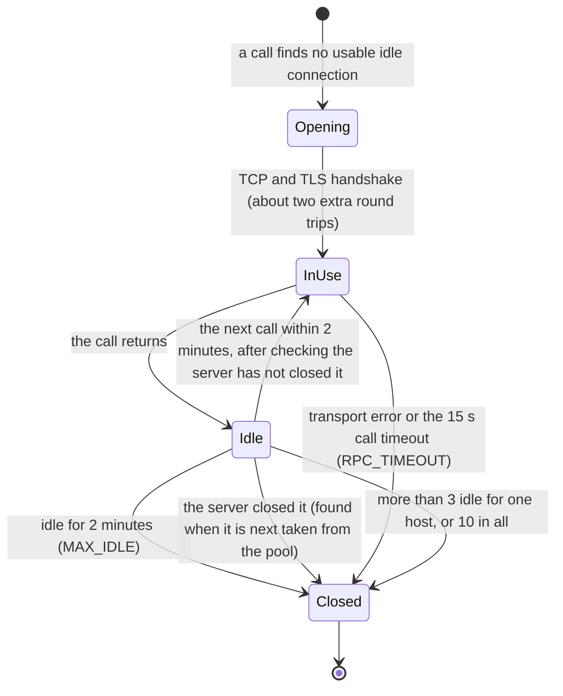

# RPC calls and latency

A sign's own work (the key lock, reading and writing the audit log) takes about 20 ms. Everything else is RPC round trips, one after another. Against `rpc1.z.ink` each round trip took about 157 ms in the traces below, so the number of calls, and whether each one needs a new connection, decide how long a sign takes.

## Connections

`Rpc::new` (`src/rpc.rs`) hands every caller in a process the same HTTP client for a given RPC URL, so they share one connection pool. In `serve` that means every request thread and every key; a CLI command is its own process, so it starts with an empty pool every time.



- **Opening** costs about two extra round trips: the first call on a new connection took 475 to 500 ms against 157 ms for the rest.
- **Idle time** is `MAX_IDLE`, 2 minutes (the library, `ureq`, defaults to 15 s, shorter than an agent's usual pause between signs). Before reusing an idle connection, `ureq` checks whether the server has closed it and opens a new one if so, so a server that closes sooner costs a handshake, not an error. The server could still close it just as it is reused; the first call of a sign is always a read, never `sendTransaction`.
- **How many:** `ureq` keeps at most 3 idle connections per host and 10 in all. Signs running at the same time in `serve` each take a connection; beyond 3 at once, the extra ones are closed after use and the next burst opens them again.
- **The process ends,** and its connections with it. Restarting `serve` starts cold.

## The genesis hash

The `chain` check compares the RPC's genesis hash with the cluster's. A process reads it once per RPC URL and reuses it for 5 minutes (`GENESIS_TTL`), so most signs make no `getGenesisHash` call, and a URL that starts answering for another chain is refused within 5 minutes. A CLI command reads it every time.

## A sign's calls

```mermaid
sequenceDiagram
    autonumber
    participant S as Signer
    participant R as RPC
    opt the genesis hash is not cached (first sign, every 5 min, every CLI command)
        S->>R: getGenesisHash
    end
    opt the payload has partial signers / creates token accounts
        S->>R: getMultipleAccounts (new accounts must not exist; token-account owners)
    end
    S->>R: getLatestBlockhash
    S->>R: getBalance (the key, before)
    S->>R: simulateTransaction
    S->>R: getFeeForMessage
    opt the simulation says BlockhashNotFound (signing only)
        S->>R: getLatestBlockhash, simulateTransaction (once, with a fresh blockhash)
    end
    opt a confirm key: after the person approves
        S->>R: getBalance, getLatestBlockhash, simulateTransaction, getFeeForMessage (a fresh blockhash)
    end
    S->>R: getBlockHeight (finalized: is the blockhash still valid?)
    opt the blockhash is already past its last valid height
        S->>R: the same four calls with a fresh blockhash, then getBlockHeight again
    end
    opt the signature is already in the audit log
        S->>R: the same four calls with a fresh blockhash
    end
    Note over S: write the sign-intent entry
    S->>R: sendTransaction (skipPreflight, maxRetries 0)
    loop wait 400 ms, then 800 ms, then 1 s, until an outcome is proven (at most 150 s)
        S->>R: getSignatureStatuses
        opt not landed yet
            S->>R: getBlockHeight (finalized), and past the blockhash's last valid height: getSignatureStatuses with history
        end
        opt every third check
            S->>R: sendTransaction (rebroadcast)
        end
    end
    S->>R: getTransaction (the exact fee and balance change; up to 10 tries)
    Note over S: write the final sign entry
```

`check` stops after `getFeeForMessage`: it neither sends nor polls. `getTransaction` stays even though it costs a round trip: the daily cap charges what a transaction actually cost, not what it was simulated to cost.

## Measured

Two signs by one session key through `serve`, about 27 s apart, against `rpc1.z.ink` (traces from 2026-11-09):

| Build | First sign | Sign after the pause | `confirm` | Calls in that sign |
|---|---|---|---|---|
| Before the connection changes | 2.76 s | 2.79 s | 1.48 s | 9 |
| One pool per URL, genesis cached | 2.80 s | 2.70 s (a new connection: 15 s idle limit) | 1.48 s | 8 |
| Plus 2 min idle, first check at 400 ms | 2.19 s | **1.70 s** | 0.88 s | 8 |

The 1.70 s is now five reads before sending (about 800 ms), the send, the 400 ms wait, the status check and `getTransaction` (about 880 ms), and about 20 ms of local work.

## Tracing a sign

Run with `SA_FORGE_SIGNER_LOG=debug` to see every RPC call with its method and duration ([Tracing](../configuration.md#tracing)), and `SA_FORGE_SIGNER_LOG_FORMAT=json` to filter it:

```sh
jq -c 'select(.fields.message == "close")
       | {span: .span.name, method: .span.method, busy: .fields."time.busy"}' trace.jsonl
```

`just bench` times the audit log's reads on synthetic logs; it does not touch the RPC.

## If a trace shows a problem

| What the trace shows | Likely cause | What to change |
|---|---|---|
| The first call of a sign after a pause takes about 3 times the others | The server closes idle connections sooner than 2 minutes | A light keep-alive call (such as `getHealth`) while `serve` is idle, or accept the handshake |
| A transport error on the first call after a pause | The server closed the connection just as it was reused | Retry a read once on a new connection; never retry `sendTransaction` blindly (a rebroadcast of the same signed transaction is safe, which the poll loop already does) |
| Handshakes during bursts of parallel signs in `serve` | More than 3 connections in use at once | Raise `max_idle_connections_per_host` |
| Every call takes 150 ms or more | Network distance to the RPC | A closer RPC ([Security](../security.md) on trusting it) |
| The five reads before sending dominate | They run one after another | Batch them as JSON-RPC batch requests (blockhash, balance and block height; then simulation and fee), if the RPC accepts batches: about 3 fewer round trips |
| Several status checks before the transaction lands | A congested cluster or slow slots | Tune the poll schedule (`FIRST_POLL`, `POLL`) |
| A CLI loop is slow on every sign | Each CLI command starts cold: a handshake and `getGenesisHash` | Run the loop through `serve` |

These are listed under "RPC latency" in the [Plan](plan.md)'s backlog; none is planned until a trace shows the need.
