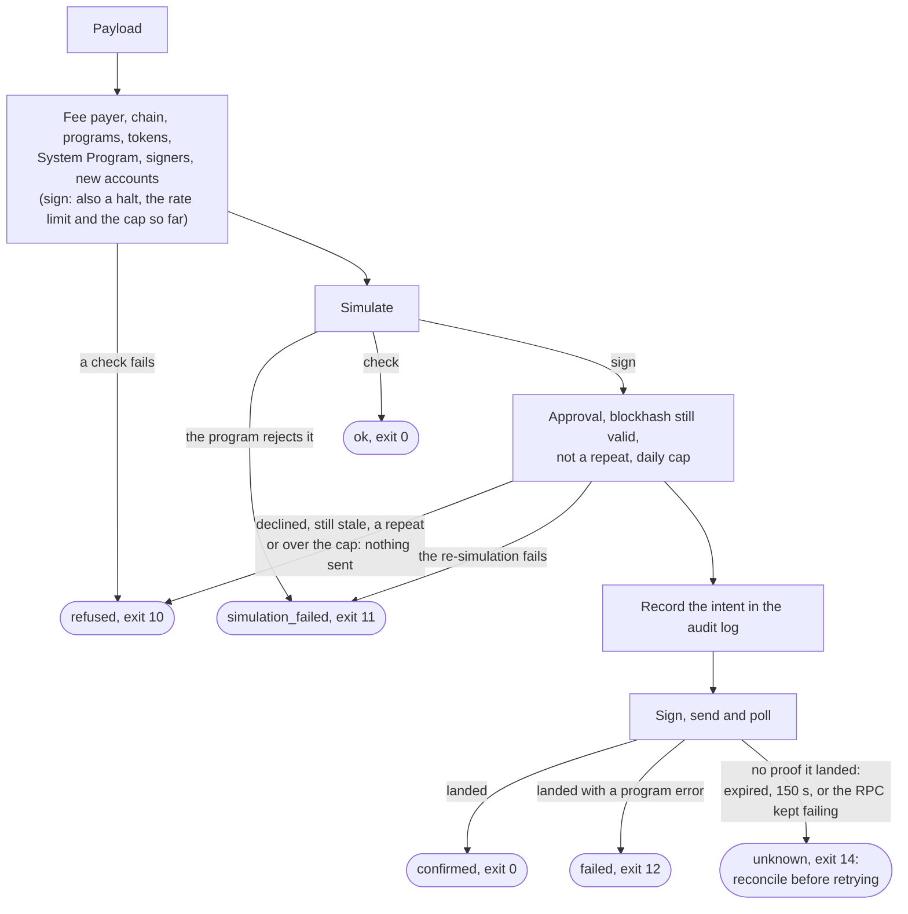

# How it works

The signer is deliberately thin: it does not decode game instructions and needs no IDL. The chain enforces what a profile key may do (scope, permission mask, expiry); the signer checks what the chain does not:

1. **Chain:** the RPC's genesis hash matches Z.ink testnet, so a wrong RPC URL cannot redirect signatures. A process reads it once and reuses it for 5 minutes, and keeps one connection pool per RPC URL, so a sign pays for neither a handshake nor this call each time.
2. **Fee payer:** the fee payer is the signing key.
3. **Programs:** every top-level instruction calls SAGE, Player Profile, Profile Faction, ComputeBudget, Associated Token or System (plus per-key extras).
4. **Tokens:** SPL Token and Token-2022 are never called at the top level, even if a key lists them as extras (token movement in play happens inside SAGE). Associated Token may only create an account, naming the real System and SPL Token or Token-2022 programs (the ATA program makes whatever token program it is given the new account's owner), and only for the signing key, one of its transfer destinations, or an existing account owned by one of the cluster's built-in game programs (a character or cargo cache). A key's `extra_programs` may be called, but never count as game programs for this rule. Creating a token account pays its rent to the owner, so an arbitrary owner would be a way to move lamports out.
5. **Compute budget:** only `SetComputeUnitLimit` up to the key's `max_compute_units` and `SetComputeUnitPrice` up to its `max_compute_unit_price` (default 0, so no priority fee), each at most once and with no accounts. Every other ComputeBudget instruction is refused (`compute_budget`), so one payload cannot spend the daily cap as a priority fee.
6. **System Program:** only `Transfer`, from the signing key, and only to per-key allowed destinations, with all of a transaction's transfers together within the key's `transfer_max_lamports` if it sets one. No account creation, assignment or allocation at the top level (forge-mcp creates new accounts inside the game programs).
7. **Signers:** every required signer is the signing key or a payload partial signer, and partial signers do not exist on-chain yet.
8. **Simulation** must succeed before anything is sent.
9. **Halt and policy approval:** a key, or every key, halted with `halt` (or by its own `halt_after_unknown`) signs nothing until a person runs `resume` at a terminal ([Halting](check-and-sign.md#halting)); a key with `require_policy_approval` signs nothing while its policy digest is not the one approved with `key approve` ([Policy digest](check-and-sign.md#policy-digest)).
10. **Limits:** a per-minute rate limit and a daily lamport cap per key, with signs serialized per key. The cap is checked against the simulation of the exact transaction about to be sent: what the key has spent or reserved in 24 h, plus this transaction's simulated spend and fee, must stay within it. A simulation that does not report the key's balance, or a missing fee estimate, is refused. The fee is quoted for the exact transaction sent, including after an approval rebuild. Each send is recorded first as an intent carrying that reservation; a spend whose outcome is not known is charged it.

With an `instruction_table` configured ([Configuration](configuration.md)), every SAGE, Player Profile and Profile Faction instruction is also compared with a table generated from the programs' IDLs: its discriminator must be listed, its account count in range, and a profile check whose signer is the key must name the key's `profile`. The table is data, not a decoder: the signer still reads no game account. Today it only reports, in `findings`.

In `sign`, after the simulation come approval (for a `confirm` key, then a fresh blockhash and a new simulation), the blockhash check, the duplicate check (a signature already in the audit log is re-signed once with a fresh blockhash, else refused), and the daily cap against that final simulation; only then is an intent recorded and the transaction sent. `check` evaluates the same checks as `sign`, through one policy function; the ones only `sign` refuses (a `deny` key, a halt, an unapproved policy, the limits and the cap) it reports in [`sign_preview`](check-and-sign.md#the-report) instead. Each step can end the request, and the outcome says which kind of step stopped it (see [Checking and signing](check-and-sign.md#outcomes)):

It then signs, sends, and polls until the transaction is confirmed, or until its blockhash is past its last valid height or 150 s pass, which end as `unknown`. Every sign request is recorded in a hash-chained audit log; [Security](security.md) covers verifying and repairing it. The log is one file that only grows, so a sign reads it from the end and stops early: the rate limit, daily cap and duplicate check read back 48 h (their 24 h window plus a day of slack for a clock stepped back), the halt's `unknown` count reads back to the key's last landed sign or `resume`, and an append reads only the last line for its hash. `audit verify` and the [console](apps/console.md) still read every line.
