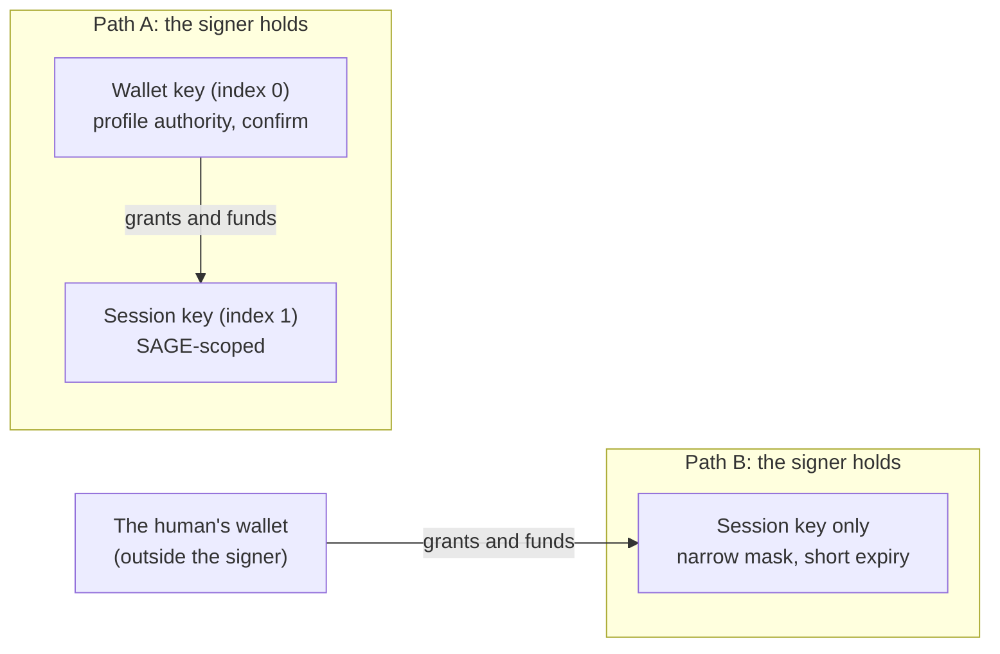
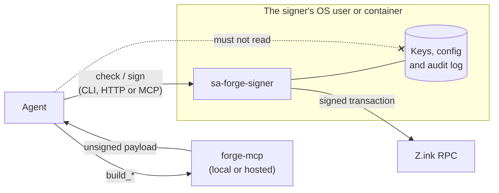

# Choosing a setup

Which keys the agent's signer holds decides what the agent can do alone and what it can lose.

## Path A: the agent holds the wallet

The agent's wallet is the profile authority (key index 0) and holds its assets; a SAGE-scoped session key (index 1) signs day-to-day play. The wallet key signs onboarding, deposits and withdrawals, vault funding and session-key funding.

> **Caution.** On mainnet this makes the agent's wallet a hot wallet. Anything that controls the agent, including a prompt injection in content it reads, can sign as the profile authority: withdraw assets, add an attacker's key, or drain the wallet. The signer cannot see what a wallet transaction does. `wallet` keys therefore default to `confirm` (a human approves each signature on the terminal). Keep only working balances in the agent's wallet. Path A suits testnet burners; on mainnet it is a deliberate, informed choice.

## Path B: the human holds the wallet

The human sets up the profile, character, faction, vault and deposits with their own wallet, then grants the agent a narrow, expiring session key. The agent's signer holds only that key.

> **Caution.** A session key is limited to the permissions granted, not to harmless actions. Within its mask it can spend in-game resources, spend from the profile vault and put fleets at risk. Grant the narrowest mask that covers the agent's job, a short expiry and a small ZINK balance, and deposit only what the agent should be able to lose.

**Recommendation:** Path B for mainnet and anything of value; Path A for testnet.

## Isolation

The signer only protects anything if the agent cannot read its keys or config. Run it as a different OS user or in a container, with the key directory and config owned by that user. If the agent can read the key file, the checks are advice, not a control.
